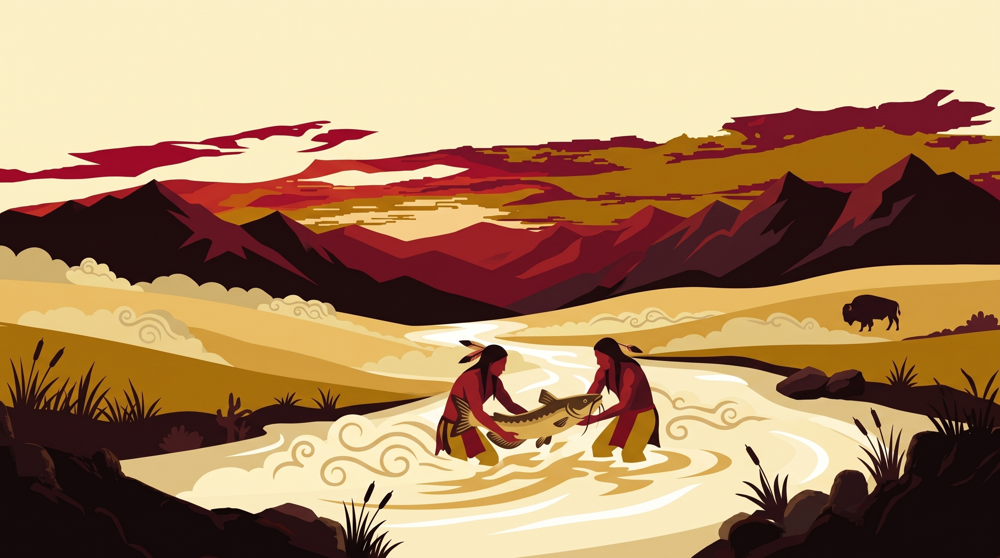
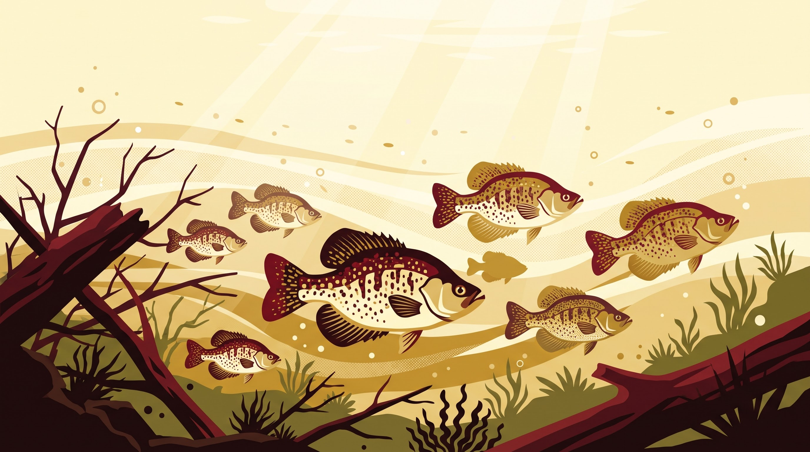
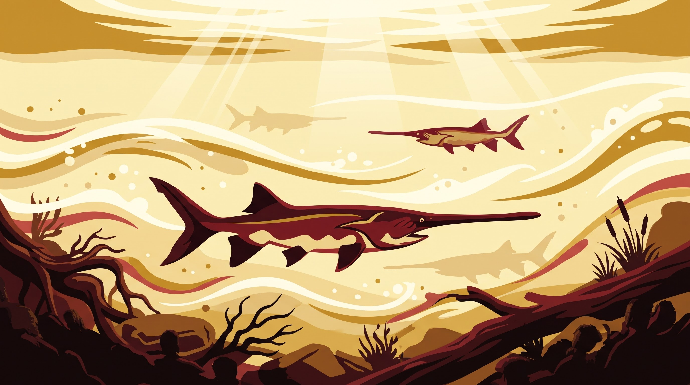
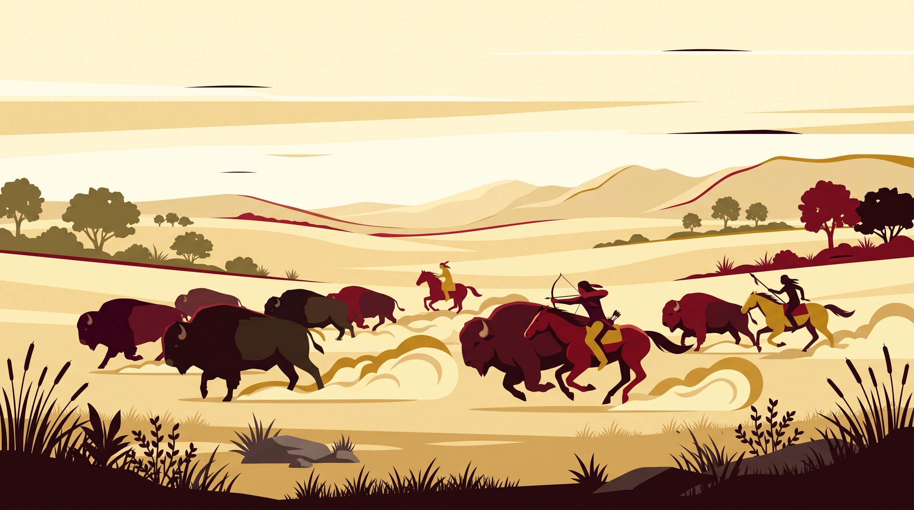
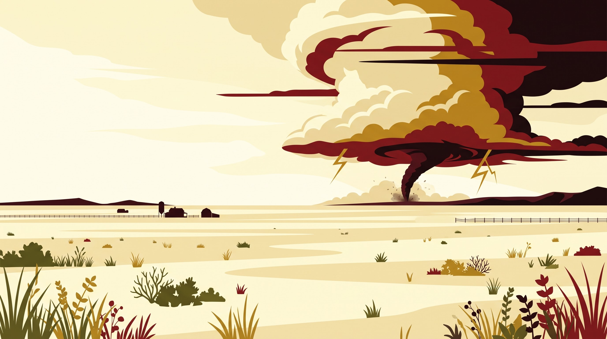

# Cream

Light theme for Omarchy. Cream surfaces, warm near-black foreground,
warm-red border. Pairs warm illustrations (`backgrounds/0-noodling.jpg`
and the outdoor photography set in `backgrounds/1-*.jpg`…`4-*.jpg`)
with a cream + warm-red palette.

The palette is anchored on a deep warm red (`#841617`) as the accent,
with cream surfaces (`#fdf9d8` → `#fffce6`) and warm near-black
foregrounds (`#2a0a0c` → `#1a0608`). The Hyprland active-border uses a
warm-red-to-bright-warm-red gradient that picks up the burgundy tones
in warm illustration art without going neon.

Cream is reserved here as readable terminal/UI foreground on the
near-black `accent`-tinted near-black foreground — never as a solid
background fill. Surfaces read lightest to darkest per the Omarchy
theme ramp (light mode: background is lightest, `darker_*` are
progressively deeper cream).

## Wallpapers

Cycle with `omarchy theme bg next` or pin one with `omarchy theme bg set <path>`:

| Index | File | Source |
|-------|------|--------|
| `0` | `0-noodling.jpg` | Noodling illustration: two figures with a fish in a winding river at sunset |
| `1` | `1-crappie-time.jpg` | Outdoor photography: Crappie Time |
| `2` | `2-spoonbill.jpg` | Outdoor photography: Spoonbill |
| `3` | `3-the-hunt.jpg` | Outdoor photography: The Hunt |
| `4` | `4-wind-sweeping.jpg` | Outdoor photography: Wind Sweeping |







Add more by dropping `<n>-<name>.<ext>` files into `backgrounds/`.
The warm-red + cream palette pairs naturally with any warm
illustration (cream sky / golden plains / burgundy mountains). Pair
intro videos by basename in `backgrounds/intros/` (e.g.
`intros/0-noodling.mp4`).

## Palette

| Role | Hex |
|------|-----|
| `accent` (warm red) | `#841617` |
| `foreground` | `#2a0a0c` |
| `bright_foreground` | `#1a0608` |
| `background` | `#fdf9d8` |
| `dark_background` | `#f3e9be` |
| `darker_background` | `#e8d59c` |
| `lighter_background` | `#fffce6` |
| `selection` | `#e8c891` |
| `muted` | `#8a7d65` |

ANSI ramps follow the standard 16-color Omarchy schema (red/yellow/
orange/green/cyan/blue/magenta/brown + bright variants). Contrast
ratios against `background`:

- `foreground` against `background` ≈ 12:1 (WCAG AAA)
- `accent` (warm red) against `background` ≈ 6:1 (WCAG AA normal text)
- `bright_foreground` against `background` ≈ 13:1 (WCAG AAA)

## Sister themes

| Theme | Mode | Wallpapers |
|-------|------|------------|
| `cream/` | light | warm cream/burgundy illustrations |
| `crimson/` | dark | pixel-art stadium, wagons-at-sunset, poster art, stadium photo |

## What's shipped

- `colors.toml` — full 26-key palette + the active-border gradient.
- `shell.toml` — overrides for the bar, notifications, menu, lock,
  polkit, launcher, and image-picker sections only. Everything else
  is generated from `default/themed/shell.toml.tpl`.
- `icons.theme` — `Yaru-red` (closest stock icon theme to the warm-red
  accent).
- `backgrounds/0-noodling.jpg` — the Noodling illustration wallpaper.
- `backgrounds/1-crappie-time.jpg`, `2-spoonbill.jpg`,
  `3-the-hunt.jpg`, `4-wind-sweeping.jpg` — outdoor photography set.
  Active image is the `~/.local/state/omarchy/current/background`
  symlink.
- `backgrounds/intros/` — empty; add matching `0-noodling.<ext>`
  intro videos here to pair with the wallpaper (see
  `default/themed/*.tpl`).

## What's intentionally NOT shipped

The following are blocked by the cloned-theme denylist
(`INSTALLED_THEME_DENIED` in `bin/omarchy-theme-set`) and would be
dropped at staging anyway:

- `*.lua` (Hyprland / Neovim / gum_env)
- terminal configs (`alacritty.toml`, `foot.ini`, `ghostty.conf`,
  `kitty.conf`)
- `vscode.json`

They are generated from `default/themed/*.tpl` using the palette
above. If a theme update pulls new templates, the denylist is the
source of truth — see `docs/theming.md` in the Omarchy repo.

## Install

```
omarchy theme install Colenado/cream
omarchy theme set cream
omarchy theme bg next   # cycle through wallpapers as you add them
```

Or locally:

```
cp -r ./* ~/.config/omarchy/themes/cream/
omarchy theme set cream
```

## Credits

- Wallpapers: Noodling illustration + the Crappie Time, Spoonbill,
  The Hunt, and Wind Sweeping photography set (user-supplied; ensure
  you have the right to redistribute them before shipping).
- Palette: warm-red + cream pairing is widely compatible with warm
  illustration art.